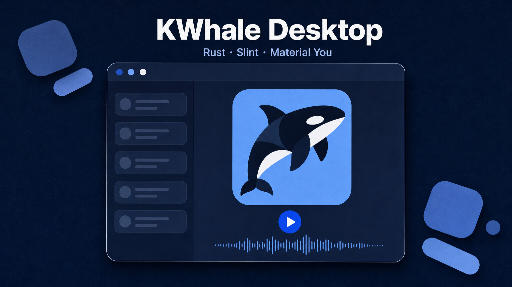
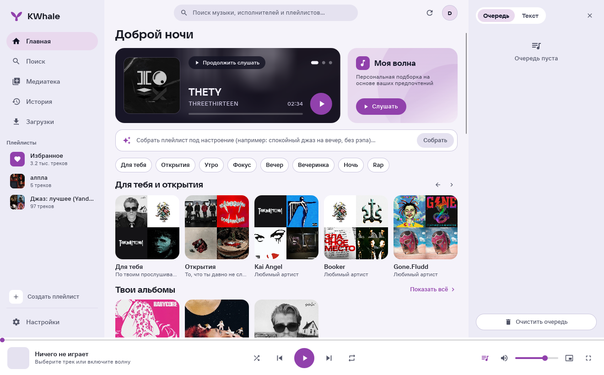
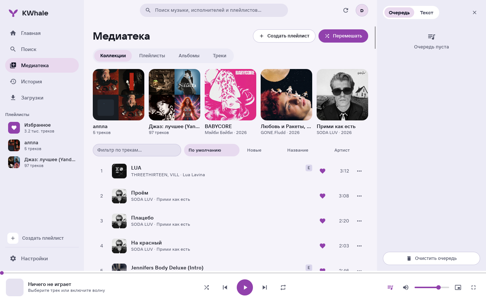
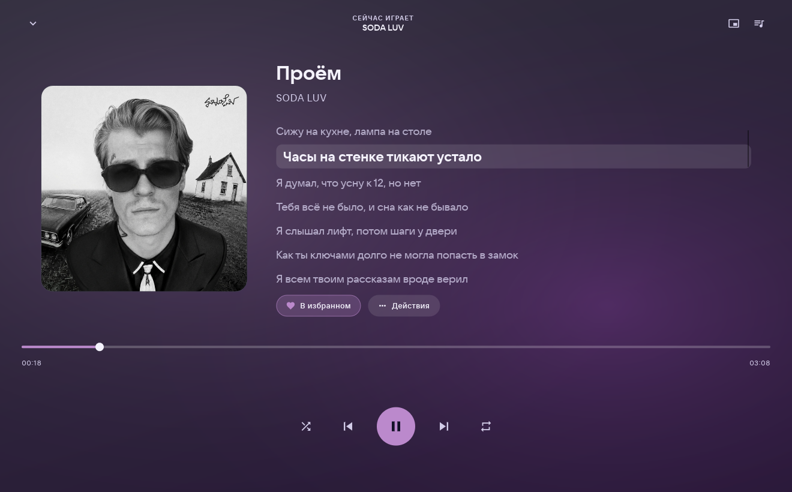

<div align="center">

**English** | [Русский](README.ru.md)

<br/>



# KWhale Desktop

**A desktop client for your KWhale Server — your music library on Linux.**

[](LICENSE)
[](https://www.rust-lang.org/)
[](https://slint.dev/)
[](#build--install-flatpak)
[](https://github.com/KWhale-Music/kwhale-desktop/actions/workflows/ci.yml)

</div>

KWhale Desktop connects to your [KWhale Server](https://github.com/KWhale-Music/kwhale-server)
and works as a regular desktop player: library, search, playlists, queue and lyrics —
no browser, no third-party clouds.

## Features

- **Connect to your server** — instance URL, sign in with email and password.
- **Play music from the server library** — no local copy, no third-party services.
- **Search** tracks, albums, artists and playlists.
- **Library** — collections, playlists, albums, tracks and favorites.
- **Queue, shuffle and repeat** — from the bottom player bar.
- **Synced lyrics** — the current line is highlighted.
- **Offline downloads** — downloaded tracks play without a network.
- **Mini-player and tray** — control playback from the system tray.
- **MPRIS** — media keys and player applets in GNOME and KDE.
- **Themes** — light, dark and accent color.
- **Single instance** — launching again raises the open window.

## Screenshots







## UI

The left sidebar holds **Home**, **Search**, **Library** (collections, playlists, albums,
tracks), **History**, **Downloads** and settings. The bottom player bar stays visible and
expands into a full-screen **Now Playing** view with cover art, progress and lyrics.
The mini-player is a separate compact window on top of other apps. Theme and accent
color are switched in settings.

## Build & install (Flatpak)

You need `org.flatpak.Builder`, `org.kde.Platform//6.11`, `org.kde.Sdk//6.11` and
`org.freedesktop.Sdk.Extension.rust-stable//25.08`:

```bash
git clone https://github.com/KWhale-Music/kwhale-desktop.git
cd kwhale-desktop
./packaging/flatpak/build-flatpak.sh
```

Prebuilt `.flatpak` bundles are published in [GitHub Releases](https://github.com/KWhale-Music/kwhale-desktop/releases).

The script vendors dependencies (`cargo vendor --locked`), builds `kwhale` and
`kwhale-ui` against the KDE runtime, exports a single-file bundle at
`target/kwhale-desktop.flatpak` and installs it into the user profile.

```bash
flatpak run org.dueattendant149.Kwhale
```

## Structure

```
kwhale-desktop/
├── Cargo.toml
├── assets/
│   ├── fonts/            # VK Sans Display and VK Sans Text
│   └── icons/            # app icons (64..512px)
├── crates/
│   ├── kwhale-core/      # /v1 API, sessions, caches, downloads, settings
│   ├── kwhale-audio/     # playback, MPRIS, single-instance
│   ├── kwhale-ui/        # Slint interface
│   └── kwhale-launcher/  # entry point
└── packaging/flatpak/    # manifest, desktop file, metainfo, build script
```

## Known issues

- **UI coverage is partial.** Some screens are still in development — polish is ongoing.
- **Linux only.** There is no Windows build; the app targets the Linux desktop.
- **Hotkeys are not implemented** in the current UI. They exist only in the experimental
  GTK/Qt backends, which are not part of the Flatpak.
- **`kwhale://` deep links** currently only raise the window; they do not open a specific track.

## Status

Beta.

## License

Code and assets are [AGPL-3.0](LICENSE). The bundled **VK Sans** fonts are excluded from
the AGPL and remain the property of their owners; treat them as replaceable design assets.

## Acknowledgements

The UI references **VK X**'s visual language. Thanks for the inspiration.
