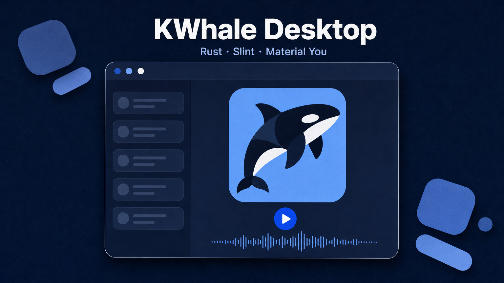

<div align="center">

[English](README.md) | **Русский**

<br/>



# KWhale Desktop

**Десктопный клиент для вашего KWhale Server — музыка из вашей библиотеки на Linux.**

[](LICENSE)
[](https://www.rust-lang.org/)
[](https://slint.dev/)
[](#сборка-и-установка-flatpak)
[](https://github.com/KWhale-Music/kwhale-desktop/actions/workflows/ci.yml)

</div>

KWhale Desktop подключается к вашему [KWhale Server](https://github.com/KWhale-Music/kwhale-server)
и работает как обычный десктопный плеер: библиотека, поиск, плейлисты, очередь и текст
песни — без браузера и без чужих облаков.

## Возможности

- **Подключение к своему серверу** — URL инстанса, вход по email и паролю.
- **Воспроизведение музыки из библиотеки сервера** — без локальной копии и сторонних сервисов.
- **Поиск** по трекам, альбомам, исполнителям и плейлистам.
- **Библиотека** — коллекции, плейлисты, альбомы, треки и избранное.
- **Очередь, shuffle и repeat** — управление из нижней панели плеера.
- **Синхронизированный текст песни** — подсветка текущей строки.
- **Оффлайн-загрузки** — скачанные треки играют без сети.
- **Мини-плеер и трей** — управление из системного лотка.
- **MPRIS** — медиаклавиши и апплеты плеера в GNOME и KDE.
- **Темы** — светлая, тёмная и акцентный цвет.
- **Один экземпляр** — повторный запуск поднимает уже открытое окно.

## Скриншоты


## UI

Слева — навигация: **Главная**, **Поиск**, **Медиатека** (коллекции, плейлисты, альбомы,
треки), **История**, **Загрузки** и настройки. Снизу — постоянная панель плеера; она
раскрывается в полноэкранный **Now Playing** с обложкой, прогрессом и текстом песни.
Мини-плеер — отдельное компактное окно поверх других. Тема и акцентный цвет
переключаются в настройках.

## Сборка и установка (Flatpak)

Требуются `org.flatpak.Builder`, `org.kde.Platform//6.11`, `org.kde.Sdk//6.11` и
`org.freedesktop.Sdk.Extension.rust-stable//25.08`:

```bash
git clone https://github.com/KWhale-Music/kwhale-desktop.git
cd kwhale-desktop
./packaging/flatpak/build-flatpak.sh
```

Готовые `.flatpak`-бандлы публикуются в [GitHub Releases](https://github.com/KWhale-Music/kwhale-desktop/releases).

Скрипт вендорит зависимости (`cargo vendor --locked`), собирает `kwhale` и
`kwhale-ui` поверх KDE-рантайма, экспортирует однофайловый бандл
`target/kwhale-desktop.flatpak` и устанавливает его в профиль пользователя.

```bash
flatpak run org.dueattendant149.Kwhale
```

## Структура

```
kwhale-desktop/
├── Cargo.toml
├── assets/
│   ├── fonts/            # шрифты VK Sans Display и VK Sans Text
│   └── icons/            # иконки приложения (64..512px)
├── crates/
│   ├── kwhale-core/      # API /v1, сессии, кэши, загрузки, настройки
│   ├── kwhale-audio/     # воспроизведение, MPRIS, single-instance
│   ├── kwhale-ui/        # интерфейс на Slint
│   └── kwhale-launcher/  # точка входа
└── packaging/flatpak/    # манифест, desktop-файл, metainfo, скрипт сборки
```

## Известные ограничения

- **UI покрыт не полностью.** Часть экранов ещё в разработке — полировка идёт постепенно.
- **Только Linux.** Windows-сборки нет; приложение рассчитано на Linux-десктоп.
- **Горячие клавиши не реализованы** в текущем интерфейсе. Они есть только в
  экспериментальных GTK/Qt-бэкендах, которые не входят в Flatpak.
- **Deep links `kwhale://`** пока только поднимают окно, но не открывают конкретный трек.

## Статус

Beta.

## Лицензия

Код и ассеты — [AGPL-3.0](LICENSE). Исключение — шрифты **VK Sans**: они не покрываются
AGPL и остаются собственностью их владельцев; это заменяемые дизайн-ассеты.

## Благодарности

UI отсылается к визуальному языку **VK X**. Спасибо за вдохновение.
