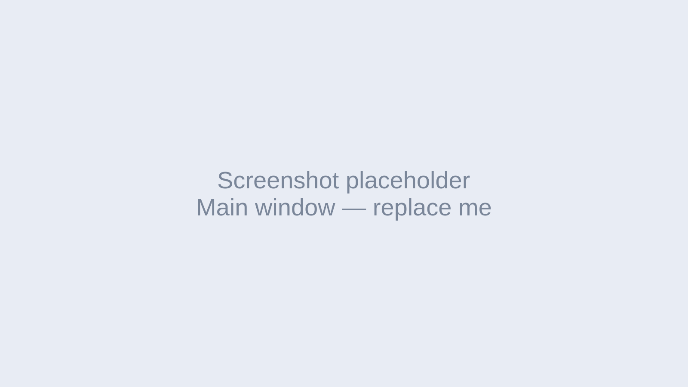
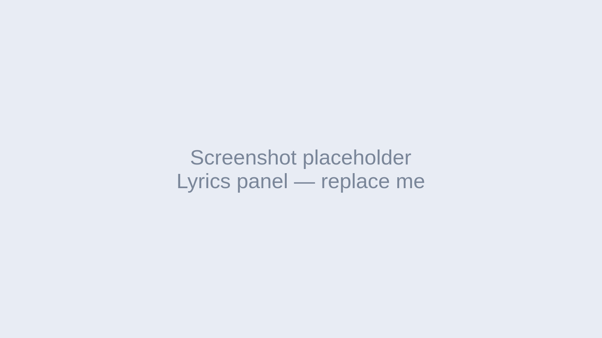

<div align="center">

[English](README.md) | **Русский**

<br/>


# KWhale Desktop

**Нативный десктоп-клиент KWhale — один адаптивный Material You UI для Linux и Windows.**

[](LICENSE)
[](https://www.rust-lang.org/)
[](https://slint.dev/)
[](#-сборка-и-установка-flatpak)

</div>

Кроссплатформенный десктоп-клиент для [KWhale Server](https://github.com/KWhale-Music/kwhale-server)
на едином Rust-ядре с интерфейсом **Material You 3** (Slint), адаптирующимся под
GNOME, KDE Plasma, нейтральные WM и Windows. Воспроизведение через GStreamer с локальным
Range/кэш-прокси, интеграция MPRIS2, синхронизированные тексты песен и deep links `kwhale://`.

## ✨ Возможности

- **Адаптивный Material You 3 UI** — тональные поверхности, 129 акцентов плюс системный
  акцент вашего окружения, метрики под GNOME / KDE / Windows.
- **Серьёзный аудио-стек** — GStreamer `playbin3`, localhost Range/кэш-прокси,
  prefetcher (5 треков вперёд), буферизация, дружелюбная к gapless.
- **Десктоп-интеграция** — MPRIS2 (медиаклавиши, апплеты плееров), единственный экземпляр
  через D-Bus-активацию, deep links `kwhale://track/{id}`, лаунчер, пересылающий ссылки
  в запущенный экземпляр.
- **UX плеера** — полноэкранный Now Playing (F11) с размытой обложкой и караоке-текстом,
  панель синхронизированного текста (Ctrl+L), панель очереди (Ctrl+Q).
- **Тот же API `/v1`** — single-flight refresh токена, кэши, реакции, загрузки;
  та же семантика, что у Android-клиента.

## 📸 Скриншоты





## 🚀 Сборка и установка (Flatpak)

Требуются `org.flatpak.Builder`, `org.kde.Platform//6.11`, `org.kde.Sdk//6.11` и
`org.freedesktop.Sdk.Extension.rust-stable//25.08`:

```bash
git clone https://github.com/KWhale-Music/kwhale-desktop.git
cd kwhale-desktop
./packaging/flatpak/build-flatpak.sh
```

Готовые `.flatpak`-бандлы публикуются в [GitHub Releases](https://github.com/KWhale-Music/kwhale-desktop/releases).

Скрипт вендорит зависимости (`cargo vendor --locked`), собирает `kwhale` и
`kwhale-ui` поверх KDE-рантайма, экспортирует однофайловый бандл `target/kwhale-desktop.flatpak`
и устанавливает его в профиль пользователя.

```bash
flatpak run org.dueattendant149.Kwhale                  # запуск
flatpak run org.dueattendant149.Kwhale kwhale://track/42  # открыть deep link
```

## ⌨️ Горячие клавиши

| Клавиша | Действие |
|---|---|
| `Space` | Воспроизведение / пауза |
| `Ctrl+←` / `Ctrl+→` | Предыдущий / следующий трек |
| `Shift+←` / `Shift+→` | Перемотка −5с / +5с |
| `Ctrl+↑` / `Ctrl+↓` | Громкость ±5% |
| `M` | Без звука |
| `Ctrl+F` / `Ctrl+K` | Фокус на поиск |
| `Ctrl+L` | Панель синхронизированного текста |
| `Ctrl+Q` | Панель очереди |
| `F11` | Полноэкранный Now Playing |

## 🏗 Структура

```
kwhale-desktop/
├── Cargo.toml
├── assets/
│   ├── fonts/            # шрифты VK Sans Display и VK Sans Text
│   └── icons/            # иконки приложения (64..512px)
├── crates/
│   ├── kwhale-core/      # REST /v1, single-flight refresh, кэши, реакции, загрузки, 129 акцентов + PlatformStyle
│   ├── kwhale-audio/     # GStreamer playbin3, localhost Range/cache прокси, prefetcher, MPRIS2
│   ├── kwhale-ui/        # единый адаптивный Material You 3 интерфейс на Slint
│   └── kwhale-launcher/  # точка входа и D-Bus активация
└── packaging/flatpak/    # манифест, desktop-файл, metainfo, скрипт сборки
```

## 🧭 Review от автора

*Честные заметки автора — плюсы, компромиссы и шероховатости.*

Чем я реально доволен:

- **Аудио-слой.** Localhost Range/кэш-прокси и prefetcher на 5 треков — тот самый скучный
  фундамент, из-за которого воспроизведение ощущается мгновенным и переживает нестабильную сеть.
- **Один UI на все десктопы.** Один Slint-интерфейс адаптируется под GNOME, KDE и Windows
  платформенными метриками вместо трёх форков тулкитов.
- **Single-instance + D-Bus deep links.** `kwhale://track/{id}` просто работает —
  из терминала и из браузера.

Что честно ещё кривое:

- **Покрытие UI частичное.** Slint-интерфейс — растущая вертикаль: Home и мини-плеер
  крепкие, часть экранов ещё заглушки по сравнению с Android-клиентом.
- **Windows отстаёт от Linux.** Работает, но темизация Windows поверхностная.
- **Настройки кэша ручные.** Глубина prefetch и бюджет кэша — константы, а не настройки.

Дальше: достройка оставшихся экранов (плейлисты, настройки), проход по Windows-теме
и вынос кэш-параметров в настройки.

## 🗺 Статус

Бета — на Linux качество daily-driver для основных сценариев воспроизведения; UI продолжает расти.

## 📄 Лицензия

[AGPL-3.0](LICENSE) — те же условия, что у сервера.

Сторонние заметки: UI отсылается к визуальному языку VK X и поставляет шрифты VK Sans,
которые остаются собственностью их владельцев — относитесь к ним как к заменяемым дизайн-ассетам.
